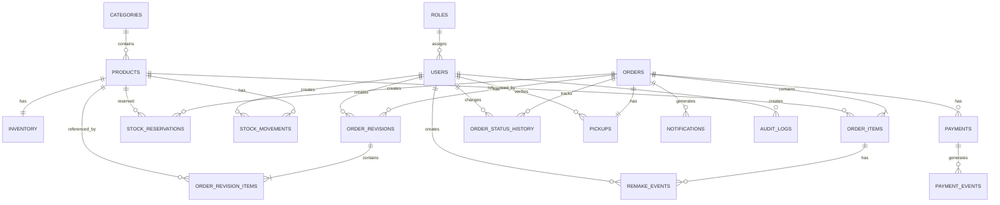

# Monster Café — Entity Relationship Diagram

## 1. Overview

ERD ini mendefinisikan struktur database utama untuk sistem POS dan self-ordering Monster Café.

Database menggunakan PostgreSQL.

Prinsip utama:

- Customer menggunakan sistem sebagai guest, tanpa akun.
- `orders.id` adalah primary key internal.
- `orders.order_number` adalah identifier yang ditampilkan kepada customer, contoh `A127`.
- Posisi antrean tidak disimpan sebagai data permanen.
- Harga dan nama produk disimpan sebagai snapshot pada `order_items`.
- Payment dan webhook harus idempotent.
- Stock reservation bersifat sementara dan dapat dilepas ketika timeout.
- Riwayat status dan tindakan sensitif harus dapat diaudit.
- Backend merupakan sumber kebenaran untuk harga, total, stok, payment, dan status order.

---

## 2. ERD Diagram



---

# 3. Entities

## 3.1 ROLES

Menyimpan role pengguna internal sistem.

| Column | Type | Constraint | Description |
|---|---|---|---|
| id | UUID | PK | Role identifier |
| name | VARCHAR | UNIQUE, NOT NULL | Nama role |
| description | TEXT | NULL | Deskripsi role |
| created_at | TIMESTAMP | NOT NULL | Waktu dibuat |
| updated_at | TIMESTAMP | NOT NULL | Waktu diperbarui |

Role yang digunakan:

- ADMIN
- CONTROLLER
- KITCHEN
- CASHIER
- PICKUP

---

## 3.2 USERS

Menyimpan akun staff dan admin.

Customer tidak memiliki akun pada MVP.

| Column | Type | Constraint | Description |
|---|---|---|---|
| id | UUID | PK | User identifier |
| role_id | UUID | FK → roles.id | Role user |
| name | VARCHAR | NOT NULL | Nama user |
| email | VARCHAR | UNIQUE, NOT NULL | Email login |
| password_hash | TEXT | NOT NULL | Password yang telah di-hash |
| is_active | BOOLEAN | NOT NULL | Status akun |
| created_at | TIMESTAMP | NOT NULL | Waktu dibuat |
| updated_at | TIMESTAMP | NOT NULL | Waktu diperbarui |

---

## 3.3 CATEGORIES

Menyimpan kategori produk.

| Column | Type | Constraint | Description |
|---|---|---|---|
| id | UUID | PK | Category identifier |
| name | VARCHAR | NOT NULL | Nama kategori |
| description | TEXT | NULL | Deskripsi kategori |
| is_active | BOOLEAN | NOT NULL | Status kategori |
| sort_order | INTEGER | NOT NULL | Urutan tampilan |
| created_at | TIMESTAMP | NOT NULL | Waktu dibuat |
| updated_at | TIMESTAMP | NOT NULL | Waktu diperbarui |

---

## 3.4 PRODUCTS

Menyimpan produk yang dapat dipesan.

| Column | Type | Constraint | Description |
|---|---|---|---|
| id | UUID | PK | Product identifier |
| category_id | UUID | FK → categories.id | Kategori produk |
| name | VARCHAR | NOT NULL | Nama produk |
| description | TEXT | NULL | Deskripsi produk |
| price | NUMERIC | NOT NULL | Harga jual |
| cost_price | NUMERIC | NOT NULL | HPP |
| image_url | TEXT | NULL | URL gambar |
| is_available | BOOLEAN | NOT NULL | Ketersediaan produk |
| created_at | TIMESTAMP | NOT NULL | Waktu dibuat |
| updated_at | TIMESTAMP | NOT NULL | Waktu diperbarui |

---

## 3.5 INVENTORY

Menyimpan stok produk.

Satu produk memiliki satu record inventory.

| Column | Type | Constraint | Description |
|---|---|---|---|
| id | UUID | PK | Inventory identifier |
| product_id | UUID | FK → products.id, UNIQUE | Produk |
| quantity_available | INTEGER | NOT NULL | Stok tersedia |
| quantity_reserved | INTEGER | NOT NULL | Stok yang sedang di-reserve |
| reorder_level | INTEGER | NOT NULL | Batas minimum stok |
| updated_at | TIMESTAMP | NOT NULL | Waktu diperbarui |

---

## 3.6 STOCK_RESERVATIONS

Menyimpan reservation stok sementara selama proses checkout/payment.

| Column | Type | Constraint | Description |
|---|---|---|---|
| id | UUID | PK | Reservation identifier |
| order_id | UUID | FK → orders.id | Order terkait |
| product_id | UUID | FK → products.id | Produk |
| quantity | INTEGER | NOT NULL | Jumlah stok yang di-reserve |
| status | VARCHAR | NOT NULL | Status reservation |
| expires_at | TIMESTAMP | NOT NULL | Batas waktu reservation |
| created_at | TIMESTAMP | NOT NULL | Waktu dibuat |
| released_at | TIMESTAMP | NULL | Waktu reservation dilepas |

Status:

- ACTIVE
- CONVERTED
- EXPIRED
- CANCELLED

---

## 3.7 STOCK_MOVEMENTS

Mencatat seluruh perubahan stok.

| Column | Type | Constraint | Description |
|---|---|---|---|
| id | UUID | PK | Movement identifier |
| product_id | UUID | FK → products.id | Produk |
| movement_type | VARCHAR | NOT NULL | Jenis movement |
| quantity | INTEGER | NOT NULL | Jumlah |
| reference_type | VARCHAR | NULL | Jenis referensi |
| reference_id | UUID | NULL | ID referensi |
| reason | TEXT | NULL | Alasan perubahan |
| created_by | UUID | FK → users.id, NULL | User |
| created_at | TIMESTAMP | NOT NULL | Waktu |

Movement type:

- SALE
- RESERVATION
- RELEASE
- RESTOCK
- ADJUSTMENT
- WASTE
- REMAKE

---

# 4. Order Domain

## 4.1 ORDERS

Entitas utama transaksi customer.

| Column | Type | Constraint | Description |
|---|---|---|---|
| id | UUID | PK | Internal order ID |
| order_number | VARCHAR | UNIQUE, NOT NULL | Nomor order customer |
| customer_name | VARCHAR | NOT NULL | Nama customer |
| tracking_token_hash | TEXT | UNIQUE, NOT NULL | Hash token tracking |
| status | VARCHAR | NOT NULL | Status order |
| subtotal | NUMERIC | NOT NULL | Subtotal |
| discount_amount | NUMERIC | NOT NULL | Nilai diskon |
| tax_amount | NUMERIC | NOT NULL | Nilai pajak |
| total | NUMERIC | NOT NULL | Total transaksi |
| payment_method | VARCHAR | NOT NULL | Metode pembayaran |
| created_at | TIMESTAMP | NOT NULL | Waktu order dibuat |
| updated_at | TIMESTAMP | NOT NULL | Waktu terakhir diperbarui |
| confirmed_at | TIMESTAMP | NULL | Waktu order confirmed |
| preparing_at | TIMESTAMP | NULL | Waktu mulai preparation |
| ready_at | TIMESTAMP | NULL | Waktu order ready |
| completed_at | TIMESTAMP | NULL | Waktu order selesai |
| cancelled_at | TIMESTAMP | NULL | Waktu order dibatalkan |

Order status:

- PENDING
- CONFIRMED
- PREPARING
- READY
- COMPLETED
- CANCELLED
- OVERDUE

Catatan:

- `id` digunakan sebagai primary key internal.
- `order_number` digunakan sebagai identifier yang ditampilkan kepada customer.
- Contoh `order_number`: `A127`.
- `order_number` bukan credential atau secret.
- Queue position tidak disimpan di tabel.

---

## 4.2 ORDER_ITEMS

Menyimpan item dalam sebuah order.

Nama produk dan harga disimpan sebagai snapshot agar histori transaksi tidak berubah ketika produk diubah di kemudian hari.

| Column | Type | Constraint | Description |
|---|---|---|---|
| id | UUID | PK | Order item ID |
| order_id | UUID | FK → orders.id | Order |
| product_id | UUID | FK → products.id | Produk |
| product_name_snapshot | VARCHAR | NOT NULL | Nama produk saat transaksi |
| unit_price | NUMERIC | NOT NULL | Harga produk saat transaksi |
| quantity | INTEGER | NOT NULL | Jumlah |
| subtotal | NUMERIC | NOT NULL | Subtotal item |
| status | VARCHAR | NOT NULL | Status item |
| created_at | TIMESTAMP | NOT NULL | Waktu dibuat |
| updated_at | TIMESTAMP | NOT NULL | Waktu diperbarui |

---

# 5. Order Revision

## 5.1 ORDER_REVISIONS

Menyimpan histori perubahan sebuah order.

Digunakan ketika customer melakukan perubahan order sebelum order masuk tahap preparation.

| Column | Type | Constraint | Description |
|---|---|---|---|
| id | UUID | PK | Revision ID |
| order_id | UUID | FK → orders.id | Order |
| revision_number | INTEGER | NOT NULL | Nomor revision |
| subtotal | NUMERIC | NOT NULL | Subtotal revision |
| discount_amount | NUMERIC | NOT NULL | Diskon revision |
| tax_amount | NUMERIC | NOT NULL | Pajak revision |
| total | NUMERIC | NOT NULL | Total revision |
| reason | TEXT | NULL | Alasan perubahan |
| created_by | UUID | FK → users.id, NULL | User yang membuat perubahan |
| created_at | TIMESTAMP | NOT NULL | Waktu perubahan |

Constraint:

```text
(order_id, revision_number) UNIQUE
```

---

## 5.2 ORDER_REVISION_ITEMS

Menyimpan snapshot item dari setiap revision.

| Column | Type | Constraint | Description |
|---|---|---|---|
| id | UUID | PK | Revision item ID |
| order_revision_id | UUID | FK → order_revisions.id | Revision |
| product_id | UUID | FK → products.id | Produk |
| product_name_snapshot | VARCHAR | NOT NULL | Nama produk |
| unit_price | NUMERIC | NOT NULL | Harga produk |
| quantity | INTEGER | NOT NULL | Jumlah |
| subtotal | NUMERIC | NOT NULL | Subtotal |

Contoh:

```text
Revision 1
- Nasi Goreng ×1
- Es Teh ×1

Revision 2
- Nasi Goreng ×1
- Es Teh ×2
- Kentang ×1
```

Revision tidak membuat order baru.

---

# 6. Payment Domain

## 6.1 PAYMENTS

Menyimpan transaksi pembayaran.

| Column | Type | Constraint | Description |
|---|---|---|---|
| id | UUID | PK | Payment ID |
| order_id | UUID | FK → orders.id | Order |
| provider | VARCHAR | NOT NULL | Payment provider |
| payment_method | VARCHAR | NOT NULL | QRIS atau CASH |
| provider_transaction_id | VARCHAR | UNIQUE, NULL | ID transaksi provider |
| amount | NUMERIC | NOT NULL | Jumlah pembayaran |
| status | VARCHAR | NOT NULL | Status pembayaran |
| paid_at | TIMESTAMP | NULL | Waktu pembayaran |
| expires_at | TIMESTAMP | NULL | Batas pembayaran |
| cash_received | NUMERIC | NULL | Uang diterima (khusus CASH) |
| change_amount | NUMERIC | NULL | Kembalian (khusus CASH) |
| cash_received | NUMERIC | NULL | Uang diterima (khusus CASH) |
| change_amount | NUMERIC | NULL | Kembalian (khusus CASH) |
| created_at | TIMESTAMP | NOT NULL | Waktu dibuat |
| updated_at | TIMESTAMP | NOT NULL | Waktu diperbarui |

Payment status:

- PENDING
- WAITING_CASH
- PAID
- FAILED
- REFUND_REQUESTED
- REFUND_PENDING
- REFUNDED
- REFUND_FAILED

---

## 6.2 PAYMENT_EVENTS

Menyimpan event atau webhook dari payment provider.

| Column | Type | Constraint | Description |
|---|---|---|---|
| id | UUID | PK | Event ID internal |
| payment_id | UUID | FK → payments.id | Payment |
| event_id | VARCHAR | UNIQUE, NOT NULL | Event ID provider |
| event_type | VARCHAR | NOT NULL | Jenis event |
| payload | JSONB | NOT NULL | Payload event |
| received_at | TIMESTAMP | NOT NULL | Waktu event diterima |
| processed_at | TIMESTAMP | NULL | Waktu event diproses |

`event_id` harus UNIQUE untuk memastikan webhook yang sama tidak diproses lebih dari satu kali.

---

# 7. Order Status History

## 7.1 ORDER_STATUS_HISTORY

Mencatat perubahan status order.

| Column | Type | Constraint | Description |
|---|---|---|---|
| id | UUID | PK | History ID |
| order_id | UUID | FK → orders.id | Order |
| from_status | VARCHAR | NULL | Status sebelumnya |
| to_status | VARCHAR | NOT NULL | Status baru |
| changed_by | UUID | FK → users.id, NULL | User yang mengubah |
| reason | TEXT | NULL | Alasan perubahan |
| created_at | TIMESTAMP | NOT NULL | Waktu perubahan |

Contoh:

```text
PENDING
   ↓
CONFIRMED
   ↓
PREPARING
   ↓
READY
   ↓
COMPLETED
```

---

# 8. Remake

## 8.1 REMAKE_EVENTS

Mencatat proses pembuatan ulang item.

Remake tetap menggunakan `order_id` dan `order_item_id` yang sama.

| Column | Type | Constraint | Description |
|---|---|---|---|
| id | UUID | PK | Remake ID |
| order_item_id | UUID | FK → order_items.id | Item yang dibuat ulang |
| reason | VARCHAR | NOT NULL | Alasan remake |
| notes | TEXT | NULL | Catatan |
| created_by | UUID | FK → users.id | User |
| created_at | TIMESTAMP | NOT NULL | Waktu remake dibuat |
| resolved_at | TIMESTAMP | NULL | Waktu remake selesai |

Contoh alasan:

- WRONG_MENU
- WRONG_SIZE
- WRONG_TOPPING
- WRONG_QUANTITY
- DAMAGED_OR_SPILLED
- CUSTOMER_REQUEST
- OTHER

---

# 9. Pickup

## 9.1 PICKUPS

Menyimpan proses pengambilan order.

Satu order memiliki satu pickup record.

| Column | Type | Constraint | Description |
|---|---|---|---|
| id | UUID | PK | Pickup ID |
| order_id | UUID | FK → orders.id, UNIQUE | Order |
| pickup_token_hash | TEXT | UNIQUE, NOT NULL | Hash token pickup |
| status | VARCHAR | NOT NULL | Status pickup |
| verified_by | UUID | FK → users.id, NULL | Staff yang memverifikasi |
| verified_at | TIMESTAMP | NULL | Waktu verifikasi |
| completed_at | TIMESTAMP | NULL | Waktu handover selesai |
| created_at | TIMESTAMP | NOT NULL | Waktu pickup dibuat |

Status:

- WAITING_PICKUP
- COMPLETED

Verifikasi pickup dicatat melalui:

- `verified_by`
- `verified_at`

Tidak diperlukan status `VERIFIED` terpisah untuk MVP.

---

# 10. Notifications

## 10.1 NOTIFICATIONS

Menyimpan notifikasi sistem.

| Column | Type | Constraint | Description |
|---|---|---|---|
| id | UUID | PK | Notification ID |
| order_id | UUID | FK → orders.id, NULL | Order terkait |
| recipient_type | VARCHAR | NOT NULL | Jenis penerima |
| recipient_id | VARCHAR | NULL | Identifier penerima |
| type | VARCHAR | NOT NULL | Jenis notifikasi |
| title | VARCHAR | NOT NULL | Judul |
| message | TEXT | NOT NULL | Isi notifikasi |
| is_read | BOOLEAN | NOT NULL | Status dibaca |
| created_at | TIMESTAMP | NOT NULL | Waktu dibuat |
| read_at | TIMESTAMP | NULL | Waktu dibaca |

Customer guest tidak memiliki foreign key ke `users`.

---

# 11. Audit Logs

## 11.1 AUDIT_LOGS

Mencatat aktivitas sensitif yang dilakukan oleh user internal.

| Column | Type | Constraint | Description |
|---|---|---|---|
| id | UUID | PK | Audit ID |
| user_id | UUID | FK → users.id, NULL | User |
| action | VARCHAR | NOT NULL | Action |
| entity_type | VARCHAR | NOT NULL | Jenis entity |
| entity_id | UUID | NULL | ID entity |
| old_value | JSONB | NULL | Data sebelum perubahan |
| new_value | JSONB | NULL | Data setelah perubahan |
| ip_address | VARCHAR | NULL | IP address |
| created_at | TIMESTAMP | NOT NULL | Waktu |

Contoh action:

- CANCEL_ORDER
- REFUND_PAYMENT
- CHANGE_PRODUCT_PRICE
- ADJUST_STOCK
- REMAKE_ITEM
- CHANGE_ORDER
- MANUAL_PAYMENT_CONFIRMATION

---

# 12. Important Constraints

## Orders

- `order_number` harus UNIQUE.
- `subtotal >= 0`.
- `discount_amount >= 0`.
- `tax_amount >= 0`.
- `total >= 0`.

## Products

- `price >= 0`.
- `cost_price >= 0`.

## Order Items

- `quantity > 0`.
- `unit_price >= 0`.
- `subtotal >= 0`.

## Inventory

- `quantity_available >= 0`.
- `quantity_reserved >= 0`.
- `reorder_level >= 0`.

## Payments

- `amount > 0`.
- `provider_transaction_id` UNIQUE jika tersedia.

## Revisions

- `(order_id, revision_number)` harus UNIQUE.

## Pickup

- Satu order hanya memiliki satu pickup record.

---

# 13. Index Strategy

Index utama yang diperlukan:

- `orders.order_number`
- `orders.status`
- `orders.created_at`
- `orders.tracking_token_hash`

- `order_items.order_id`
- `order_items.product_id`

- `products.category_id`
- `products.is_available`

- `stock_reservations.order_id`
- `stock_reservations.product_id`
- `stock_reservations.status`
- `stock_reservations.expires_at`

- `stock_movements.product_id`
- `stock_movements.created_at`

- `payments.order_id`
- `payments.provider_transaction_id`
- `payments.status`

- `payment_events.payment_id`
- `payment_events.event_id`

- `order_status_history.order_id`
- `order_status_history.created_at`

- `remake_events.order_item_id`

- `pickups.order_id`
- `pickups.pickup_token_hash`

- `notifications.order_id`

- `audit_logs.user_id`
- `audit_logs.entity_type`
- `audit_logs.entity_id`
- `audit_logs.created_at`

Index tambahan dapat ditambahkan berdasarkan profiling query setelah sistem berjalan.

---

# 14. Queue Design

Queue position tidak disimpan sebagai column pada `orders`.

Posisi antrean dihitung berdasarkan order aktif dan urutan waktu.

Contoh:

```text
A124  PREPARING
A125  PREPARING
A126  CONFIRMED
A127  CONFIRMED  ← customer
```

Customer dapat melihat:

```text
12 pesanan sedang dikerjakan
Posisi antrean: #4
Estimasi: 15–20 menit
```

Informasi tersebut dihitung oleh backend dan bukan data permanen dalam database.

---

# 15. Guest Customer Security

Customer tidak memiliki account.

Customer menggunakan:

- `order_number` untuk identifikasi manusia.
- secure tracking token untuk mengakses tracking order.
- secure pickup token untuk proses pickup.

`order_number` bukan credential.

Token asli tidak disimpan secara plaintext di database.

Database hanya menyimpan hash token.

---

# 16. Source of Truth

PostgreSQL merupakan source of truth untuk:

- orders
- order items
- payments
- inventory
- stock movements
- order status
- pickup
- audit history

Frontend tidak boleh menjadi sumber kebenaran untuk:

- harga
- total
- stok
- payment status
- permission
- order status

Semua nilai penting harus divalidasi dan dihitung kembali oleh backend.

---

# 17. Database Design Principles

Database harus mendukung:

1. Transaction integrity
2. Concurrent checkout
3. Atomic stock update
4. Idempotent payment processing
5. Idempotent webhook processing
6. Historical order snapshots
7. Auditability
8. Secure guest access
9. Reliable order tracking
10. Analytics tanpa mengganggu transaksi utama

---

# 18. MVP Scope

Database MVP menggunakan inventory berbasis produk.

Belum termasuk:

- ingredient inventory
- bill of materials
- supplier management
- purchase orders
- warehouse management
- multi-branch inventory

Fitur ingredient/BOM dapat ditambahkan pada fase berikutnya tanpa mengubah core order architecture.

---

# 19. Final Entity List

Database MVP terdiri dari 18 entity utama:

1. `roles`
2. `users`
3. `categories`
4. `products`
5. `inventory`
6. `stock_reservations`
7. `stock_movements`
8. `orders`
9. `order_items`
10. `order_revisions`
11. `order_revision_items`
12. `payments`
13. `payment_events`
14. `order_status_history`
15. `remake_events`
16. `pickups`
17. `notifications`
18. `audit_logs`

ERD ini menjadi dasar untuk SQLAlchemy models, Alembic migrations, repository layer, service layer, dan API implementation.